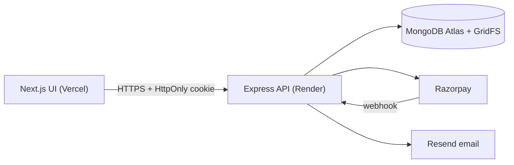

# NicheHire: Niche Job Board and Applicant Tracking System (ATS)

NicheHire is a full-stack job marketplace for **specialised ("niche") roles**. Employers post jobs whose form fields change with the niche (AI/ML, Cybersecurity, Nursing and so on). Candidates apply with a PDF resume. The system reads the resume, compares it with the job's required skills, and shows the employer a skill-coverage score so applicants can be reviewed faster. Administrators moderate the platform and see platform-wide analytics.

> This documentation describes what the source code actually does. Where something could not be tested or is broken, it is marked **NOT VERIFIED** or **KNOWN ISSUE**. See [Current status and known issues](#current-status-and-known-issues).

## Table of contents
1. [Problem statement](#problem-statement) · 2. [Objectives](#objectives) · 3. [Features](#features) · 4. [Technology stack](#technology-stack) · 5. [Architecture overview](#architecture-overview) · 6. [Prerequisites](#prerequisites) · 7. [Installation](#installation) · 8. [Environment variables](#environment-variables) · 9. [Local development commands](#local-development-commands) · 10. [Build and test](#build-and-test) · 11. [Deployment](#deployment) · 12. [Troubleshooting](#troubleshooting) · 13. [Current status and known issues](#current-status-and-known-issues) · 14. [Documentation map](#documentation-map)

## Problem statement
General job boards mix thousands of unrelated roles. For specialised hiring, employers receive many applications that do not meet the technical requirements, and candidates cannot easily describe niche-specific needs (for example "ML frameworks", "nursing licence", "smart-contract languages") in a generic form. Reviewing resumes by hand is slow.

## Objectives
- Let employers describe jobs with niche-specific, validated fields.
- Let candidates apply quickly with a PDF resume and track every application.
- Give employers an explainable, deterministic skill-coverage score for each resume.
- Give each role a suitable dashboard: candidate, employer, administrator.
- Offer a paid "featured job" promotion (Razorpay) and in-app plus email notifications.
- Provide analytics and CSV reports, and moderation tools with an audit trail.
- Keep the system secure enough for production (see `docs/SECURITY_AND_DEPLOYMENT.md`).

## Features
Every item below was checked against the source code. "UI" means a frontend page exists; "API" means a backend endpoint exists. Items marked **(not verified live)** depend on external services that were not available during testing.

| Area | What exists |
|---|---|
| Accounts | Register as candidate or employer, login, logout, "log out of all devices" (API), forgot/reset password by email link, editable profile with completion percentage (UI + API) |
| Roles | `candidate`, `employer`, `admin` with server-side authorisation; admins can only be created with a command-line script |
| Jobs | Post, edit, close jobs; 7 niche categories with category-specific validated fields (UI + API) |
| Job browsing | `/jobs` listing page with a search box (title, company, description or skill), category, location and employment-type filters, "Clear filters", 12 jobs per page with Previous/Next, featured jobs first, and shareable URLs (for example `/jobs?category=Cybersecurity&page=2`). The home page also shows recent jobs and category links |
| Job details | Description, required skills, niche requirements, save job, apply panel (UI) |
| Applications | PDF resume upload, duplicate protection, candidate "My applications" list, employer applicant table with status (Applied / Shortlisted / Rejected), resume download (UI + API) |
| Resume matching | Deterministic keyword skill matching with an alias dictionary. **Not machine learning.** |
| Saved jobs | Save/unsave, saved list (UI + API) |
| Notifications | In-app notifications (bell, list, mark read) and email through Resend **(email not verified live)** |
| Payments | Featured-job promotion for INR 499 for 7 days by default, via Razorpay Checkout, with signature and webhook verification **(not verified against live Razorpay)** |
| Analytics | Employer, per-job, candidate and admin platform analytics with date ranges and CSV exports |
| Admin | Overview, user list and suspend/reactivate, job moderation (flag/unflag/remove/restore), payments overview, application analytics, platform analytics, audit log |

## Technology stack
| Layer | Technology (versions from `package.json`) |
|---|---|
| Frontend | Next.js 16.4.3 (App Router), React 19.3, Tailwind CSS 4, lucide-react icons |
| Backend | Node.js 22.x, Express 5, Zod 4 (validation), bcryptjs, jsonwebtoken, cookie-parser, cors, helmet, express-rate-limit, multer, pdf-parse |
| Database | MongoDB (Atlas in production) with Mongoose 9; GridFS for resume files |
| Authentication | JWT in an HttpOnly cookie plus a server-side session record; role-based authorisation |
| Payments | Razorpay (Orders API, Checkout, webhooks) |
| Email | Resend HTTPS API |
| Hosting | Vercel (frontend), Render (backend) |
| Version control | Git and GitHub |
| Tests | Node.js built-in test runner (`node --test`) |

## Architecture overview

The browser talks only to the API, always with `credentials: include`. The API validates every request, checks the session and role, and talks to MongoDB, Razorpay and Resend. Details and more diagrams: `docs/SYSTEM_ARCHITECTURE.md`.

Repository layout:
```
backend/    Express API: config, controllers, middleware, models, routes, services, utils, validators, tests, scripts
frontend/   Next.js app: app/ (pages), components/, hooks/, lib/
```

## Prerequisites
- **Node.js 22.x** (the project pins `22.x`) and npm
- A **MongoDB** database: a free MongoDB Atlas cluster, or a local MongoDB for development
- Git
- Optional: a Razorpay account (test mode) for payments, a Resend account and verified sender for email. The app runs without them: payments report "not configured", email is skipped, in-app notifications still work.

## Installation
```bash
git clone <your-repository-url> nichehire
cd nichehire
```

### Backend setup
```bash
cd backend
npm install
cp .env.example .env        # then edit .env (see "Environment variables"); .env is git-ignored
npm run dev                 # API on http://localhost:5000
```
Create the first administrator (there is deliberately no API route for this):
```bash
npm run create-admin        # prompts for name, e-mail and a password of at least 12 characters
```
Check it is running: open `http://localhost:5000/api/health`.

### Frontend setup
```bash
cd frontend
npm install
cp .env.local.example .env.local   # sets NEXT_PUBLIC_API_URL (the template is committed; .env.local is git-ignored)
npm run dev                 # UI on http://localhost:3000
```
Open `http://localhost:3000`. Use `localhost` consistently (not a mix of `localhost` and `127.0.0.1`) so the login cookie is sent.

## Environment variables
Use placeholders only; never commit real values (`.env` files are git-ignored).

**backend/.env**
```
NODE_ENV=development
PORT=5000
MONGO_URI=<your-mongodb-connection-string>
JWT_SECRET=<random string of at least 32 characters>
JWT_EXPIRES_IN=7d
CORS_ORIGIN=http://localhost:3000
FRONTEND_URL=http://localhost:3000
COOKIE_SAMESITE=lax

# Optional features
RAZORPAY_KEY_ID=<razorpay-key-id>
RAZORPAY_KEY_SECRET=<razorpay-key-secret>
RAZORPAY_WEBHOOK_SECRET=<razorpay-webhook-secret>
FEATURED_PRICE_PAISE=49900
FEATURED_DAYS=7
RESEND_API_KEY=<resend-api-key>
EMAIL_FROM=<verified sender, e.g. NicheHire <no-reply@your-domain>>
```
Generate a JWT secret: `node -e "console.log(require('crypto').randomBytes(48).toString('hex'))"`.
The server refuses to start (with a clear message) if `MONGO_URI` is missing, `JWT_SECRET` is shorter than 32 characters or a placeholder, `COOKIE_SAMESITE` is not `lax`/`strict`/`none`, or `JWT_EXPIRES_IN` is not like `7d`, `12h`, `30m`. In production `CORS_ORIGIN` must be exact `https://` origins. Optional tuning variables (rate limits, PDF limits, keep-alive) are listed in `backend/.env.example`.

**frontend/.env.local**
```
NEXT_PUBLIC_API_URL=http://localhost:5000
```

## How the main ideas work

### Niche categories ("vertical-switcher")
One file, `backend/config/categories.json`, defines the seven categories and each category's extra fields (type, label, options, required). The same file validates job postings on the server, is served by `GET /api/categories`, and is used by the frontend to draw the posting form, so the form and the validation can never disagree. Field types: `select`, `multiselect`, `tags`, `boolean`, `text`. To add a niche or a field, edit that file; no other code change is needed. Jobs saved under older category names (`Frontend`, `Web3`, `Nursing`) must be re-categorised.

### Resume skill matching
When a candidate applies, the PDF text is extracted (first 15 pages, 8-second limit) and each of the job's required skills is looked for as a whole word, with an alias list (for example `k8s` counts as Kubernetes; `java` does not match `javascript`). Score = skills found / skills required x 100. It is deterministic and explainable, **not machine learning**; scanned images give "unavailable". Only the employer sees the score, the matched and the missing skills.

## Local development commands
| Where | Command | Purpose |
|---|---|---|
| backend | `npm run dev` | API with auto-restart (nodemon) |
| backend | `npm start` | API without auto-restart |
| backend | `npm run create-admin` | create or promote an administrator |
| backend | `npm run migrate-resumes` | copy resumes still stored on local disk into GridFS (only needed for data from older versions) |
| frontend | `npm run dev` | Next.js dev server |

## Build and test
```bash
# Backend tests (213 tests). Database tests run only when MONGO_URI_TEST points to a database whose name contains "test".
cd backend
MONGO_URI_TEST="mongodb://127.0.0.1:27017/nichehire_test" JWT_SECRET="<32+ random chars>" npm test

# Frontend
cd frontend
npm run lint
npm run build               # production build
npm start                   # serve the production build

# End-to-end runtime verification of every implemented feature through the real UI (51 checks)
cd e2e && npm install && npm run install-browser
E2E_ADMIN_EMAIL=<admin> E2E_ADMIN_PASSWORD=<password> E2E_MONGO_URI=<test database uri> npm run verify
```
Without `MONGO_URI_TEST` the database-backed backend tests are skipped (they are reported as skipped, so a "green" run without a database proves less). The end-to-end suite is described in `e2e/README.md`; it needs the backend, the frontend and MongoDB running, and an administrator account. Results of the documentation milestone are in `docs/TESTING_DOCUMENTATION.md` and `e2e/results/last-run.md`.

## Deployment
Short version (full steps and a verification checklist are in `docs/SECURITY_AND_DEPLOYMENT.md`):
1. **MongoDB Atlas:** create a cluster and a database user; allow Render's outbound addresses in Network Access.
2. **Render (backend):** new Web Service from the `backend` folder; build `npm install`, start `npm start`; set the environment variables (`NODE_ENV=production`, `MONGO_URI`, a fresh `JWT_SECRET`, `CORS_ORIGIN=https://<your-vercel-domain>`, `FRONTEND_URL`, `COOKIE_SAMESITE=none`, plus Razorpay and Resend variables); health check path `/api/health`.
3. **Vercel (frontend):** import the `frontend` folder; set `NEXT_PUBLIC_API_URL=https://<your-render-service>.onrender.com`; deploy.
4. **Razorpay:** add the webhook `https://<your-render-service>/api/payments/webhook` with the events `payment.captured`, `payment.failed`, `order.paid` and copy its secret into `RAZORPAY_WEBHOOK_SECRET`.
5. Create the admin with `npm run create-admin` from a machine that has the production `MONGO_URI` set temporarily in its environment.

## Troubleshooting
| Symptom | Likely cause and fix |
|---|---|
| Server exits at start with a list of problems | An environment variable is missing or invalid; the message names it. Fix `.env` and restart |
| Login succeeds but you are sent back to the login page (production) | Frontend and API are on different sites: set `COOKIE_SAMESITE=none` on Render, and `CORS_ORIGIN` to the exact Vercel URL |
| `403 Cross-origin request blocked` (`CSRF_BLOCKED`) | The browser's `Origin` is not in `CORS_ORIGIN`. Add the exact origin (scheme + host, no trailing slash) |
| `429 Too many ...` | Rate limit reached (login attempts per IP/account, uploads per user). Wait 15 minutes (login) or one hour (uploads) |
| `503 The service is temporarily unavailable` | The API cannot reach MongoDB (Atlas down, wrong URI, IP not allowed). `/api/ready` returns 503 in this state |
| Cookie not sent locally | Open the UI at `http://localhost:3000` and the API at `http://localhost:5000` (same host name) |
| "Payments are not configured" | `RAZORPAY_KEY_ID` / `RAZORPAY_KEY_SECRET` are not set; set them (test keys) |
| No emails arrive | `RESEND_API_KEY` / `EMAIL_FROM` not set or sender not verified; the server log says "Email: DISABLED". In-app notifications still work |
| Resume shows "match unavailable" | The PDF has almost no extractable text (scanned image) or the job has no required skills |
| Resume upload rejected | Must be a real PDF of at most 5 MB (the file signature is checked) |
| `/jobs` shows an error instead of jobs | A filter in the URL is invalid (for example an unknown `category`), or the API is unreachable. Click **Clear filters** or **Retry**; check `NEXT_PUBLIC_API_URL` |
| `/employer` or `/candidate` shows 404 | Fixed by redirects in `frontend/next.config.mjs`; make sure you deployed the latest frontend |

## Current status and known issues
- **Job listing page restored (follow-up fix in Milestone 11).** In the originally supplied source, `frontend/components/JobsBoard.jsx` contained a copy of the `SpotlightCard` component, so `/jobs` rendered blank. The component was rewritten to use the existing API and shared components (`JobCard`, `Pagination`, `Field`, `useApi`, `useCategories`). It was verified in a real browser (27 of 27 checks, see `docs/TESTING_DOCUMENTATION.md`). If your Git repository still has the old file, copy the restored `frontend/components/JobsBoard.jsx` from this package.
- Razorpay checkout, Resend delivery and live Render/Vercel behaviour were **NOT VERIFIED** (no accounts or keys in the test environment). Payment logic is covered by automated tests with a stubbed gateway.
- The resume match is keyword based. It is not AI/machine learning and cannot read scanned PDFs.
- The "promotion" fields `pinnedUntil` and `urgentUntil` on jobs exist in the schema but no endpoint sets them.
- Application status history is not stored (only the current status).
- The unmodified frontend production build could not be verified in the documentation sandbox (it cannot reach Google Fonts); a build with that one import stubbed compiled successfully.

## Documentation map
| File | Contents |
|---|---|
| `docs/SYSTEM_ARCHITECTURE.md` | Architecture, flows, diagrams |
| `docs/API_DOCUMENTATION.md` | Every endpoint with examples |
| `docs/DATABASE_DOCUMENTATION.md` | Collections, fields, indexes, relationships |
| `docs/USER_GUIDE.md` | Step-by-step guides for candidates, employers, admins |
| `docs/SECURITY_AND_DEPLOYMENT.md` | Verified protections, deployment, checklist |
| `docs/TESTING_DOCUMENTATION.md` | Strategy and actual results |
| `PRODUCT_OVERVIEW.md` | Vision, users, value, revenue model, roadmap |
| `presentation/NICHEHIRE_FINAL_PROJECT_PRESENTATION.pptx` | Final presentation (PDF copy alongside) |
| `e2e/` | End-to-end verification suite (Playwright), its README and the last results |
| `assets/screenshots/`, `assets/diagrams/` | Real application screenshots (demo data) and the Mermaid diagram sources used by the documents |
| `docs/JOB_BOARD_FIX_NOTES.md` | What was wrong with the job listing page and how it was restored |
